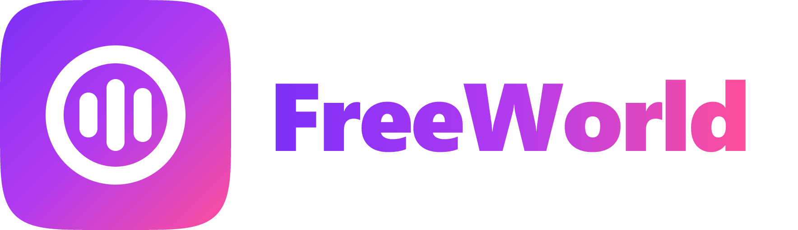
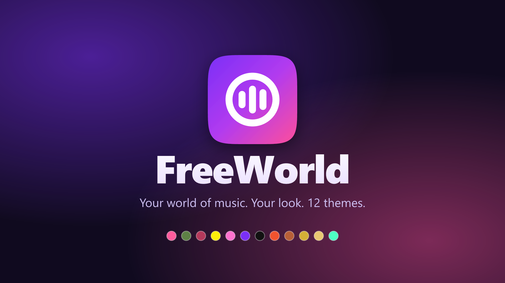

 

### Your world of music. Your look.

 

[**Features**](#features) · [**Themes**](#themes) · [**Download**](#download) · [**Build**](#build-from-source) · [**Disclaimer**](#disclaimer) · [**License**](#license)

> [!IMPORTANT]
> FreeWorld is not affiliated with, endorsed by, or connected to YouTube, Google, Spotify or Discord in any way. Use it at your own discretion.

---

## Features

FreeWorld is a free, open-source music player for **Android**, **Android TV**, **Wear OS**, the **web** and a companion **browser extension**.

#### Playback
- **Search, browse and play** anything available on YouTube Music.
- **Hi-Res lossless audio**: FLAC/ALAC from a configured module source, with YouTube Music as the fallback.
- **Gapless playback with true crossfade**, adjustable from 0 to 12 s.
- **Automix (beta)**: DJ-style transitions with beat-matching and tempo-stretching.
- **Offline downloads** with embedded metadata.
- **Local music library** support.
- **Background playback** through a proper media session.

#### Connectivity & accounts
- **Sign in with Google** for personalized content.
- **Spotify**: connect your account to play your playlists and Liked Songs.
- **Discord Rich Presence**: show what you're listening to.
- **Scrobbling** to Last.fm and ListenBrainz.
- **Listen Together**: up to five devices play the same song in sync with a six-character party code.
- **Pluggable sources**: add, edit, test and health-check module sources.

#### Experience
- **12 switchable themes** across the app, web player and extension (see below).
- **Word-synced lyrics** with smooth, word-by-word highlighting from multiple providers.
- **Animated album canvas** on the now-playing screen.
- **Artwork-driven colours** on the now-playing screen.
- **Frosted-glass bars** and Material 3 design.
- **Alternate app icons**: glass styles for Apple-, Samsung- and Pixel-style home screens.

#### Controls & tweaks
- **Per-network audio quality**: separate limits for Wi-Fi and mobile data.
- **Playback speed** (0.5×–2.0×) and **skip silence**.
- **Sleep timer**: fixed presets or "stop after this track".
- **System equalizer** integration.
- **Stats for nerds**: codec, bit depth, sample rate and more.

## Themes

Pick a theme in **Settings → Appearance → Theme** (app and web player) or from the dropdown in the extension's popup. Your choice applies instantly and is remembered.

| Soft & Cute | Futuristic & Retro | Artistic & Indie | Mystical & Fantasy |
|---|---|---|---|
| Kawaii | Cyberpunk | Minimalist | Witchcore |
| Cottagecore | Vaporwave | Indie Kid | Zodiac |
| Coquette | 90s Kid | Boho | Glowwave |

**Classic** keeps the original look and follows your system's light or dark mode. Every other theme has its own fixed light or dark mode. The full colour specification lives in [docs/FREEWORLD_THEMES.md](docs/FREEWORLD_THEMES.md).

## Download

Get the latest APK from the [**Releases**](../../releases) page. Sideloading requires allowing "Install unknown apps" for the app you download it with.

## Build from source

| Part | Folder | Requirements | Command |
|---|---|---|---|
| Android app | `app/` | JDK 17+, Android SDK 36 | `./gradlew :app:assembleDevDebug` |
| Android TV | `tv/` | same | `./gradlew :tv:assembleDevDebug` |
| Wear OS | `wearos/` | same | `./gradlew :wearos:assembleDevDebug` |
| Web player | `web/app/` | Node 22+, pnpm | `pnpm install` then `pnpm dev` (in `web/`) |
| Extension | `web/extension/` | Node 22+, pnpm | `pnpm dev:ext` (in `web/`) |
| Listen Together server | `backend/` | Go | `go run .` |

- **Android:** create `local.properties` with `sdk.dir=<path to your Android SDK>`. The APK lands in `app/build/outputs/apk/dev/debug/`.
- **Web player:** needs `VITE_PARTY_SERVER_URL` in `web/app/.env.local`, pointing at a Listen Together server.
- **Server:** [backend/README.md](backend/README.md) explains how the server works and how to deploy your own (Oracle Cloud Always Free or Render).

See [CONTRIBUTING.md](CONTRIBUTING.md) for tests and the pull-request workflow.

## Disclaimer

FreeWorld is an independent, community-driven audio player. It is **not** associated with Google LLC, YouTube Music, Spotify, Discord, Deezer, Telegram or any of their parent companies.

- **No media hosting:** FreeWorld does not host, upload or store copyrighted music. It plays files from your device or streams from public or user-authenticated services.
- **Your responsibility:** you are responsible for making sure your use complies with your local copyright laws and the terms of the services you connect.
- **No guarantees:** third-party services can change at any time, and features that depend on them may stop working.

## License

FreeWorld is free software under the **GNU General Public License v3.0**; see [LICENSE](LICENSE). Any distribution must include the corresponding source code under the same license.

FreeWorld is a modified version of BitChord, © its contributors, licensed under GPLv3. Modified on 29 October 2026: rebranded, with a new logo and a switchable theme system.
